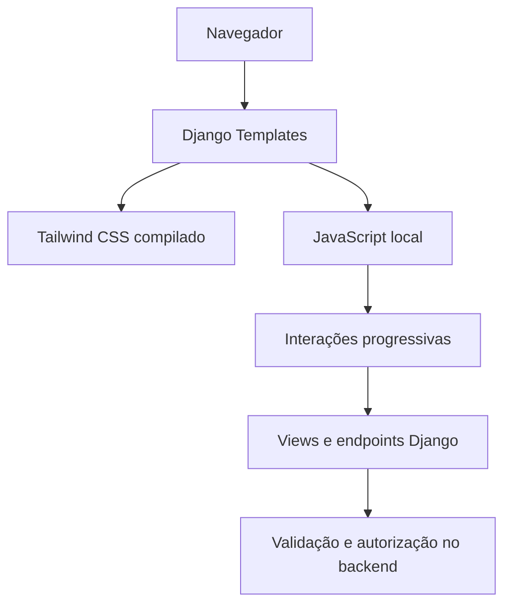

# Frontend e Experiência do Usuário — TeachFlow

## 1. Objetivo

Este documento descreve a abordagem de interface do TeachFlow e as escolhas de experiência que acompanharam a evolução do MVP. O objetivo não é inventariar cada classe CSS ou evento JavaScript, mas explicar a organização visual, a responsabilidade de cada camada e os padrões que devem permanecer consistentes.

**Base documental:** histórico das auditorias e decisões do projeto. Nomes exatos de arquivos e detalhes de implementação devem ser reconferidos no repositório sempre que a documentação for atualizada.

## 2. Princípio de experiência

O TeachFlow é um **diário de trabalho do professor**, não um painel institucional de fiscalização. A interface deve priorizar:

- clareza sobre o que será registrado;
- acesso rápido a dados correntes e históricos;
- reaproveitamento de informações já cadastradas;
- confirmação antes de ações destrutivas;
- explicações úteis para erros e bloqueios reais;
- ausência de etapas burocráticas sem benefício concreto.

A aplicação deve auxiliar o professor a trabalhar, não exigir que ele se adapte a uma sequência artificial de aprovações.

## 3. Arquitetura de apresentação



O HTML é renderizado pelo Django. Tailwind CSS organiza estilos e componentes visuais. JavaScript aprimora a interação onde necessário.

O backend continua responsável por autenticação, ownership, regras de negócio e persistência, mesmo quando a interface utiliza AJAX.

## 4. Organização de templates

O projeto utiliza a pasta `templates/` em minúsculas. Essa padronização foi feita deliberadamente para evitar divergências entre sistemas de arquivos Windows e Linux.

As páginas compartilham uma base visual e se organizam por domínio, incluindo áreas de:

```text
templates/
├── accounts/
├── dashboard/
├── classes/
├── students/
├── lessons/
├── exercises/
└── ... outras áreas da aplicação
```

Esta árvore é **ilustrativa**, não um inventário exaustivo dos arquivos existentes.

## 5. Tailwind CSS e build

Tailwind CSS é compilado localmente e o resultado é entregue como arquivo estático da aplicação.

A decisão favorece consistência visual e evita depender de uma CDN de Tailwind em produção.

O arquivo compilado, como `static/css/build.css`, é um artefato gerado. Auditorias de código e buscas textuais devem preferir fontes HTML/JS/configuração e **excluir o CSS compilado**, evitando saídas enormes e pouco informativas.

Alterações de classes Tailwind e de caminhos de templates exigem reconstrução e verificação do CSS gerado.

## 6. JavaScript progressivo

O JavaScript é utilizado para melhorar tarefas como:

- filtros e atualização da interface;
- modais e confirmações;
- criação rápida de recursos;
- interações com exercícios e progresso;
- formulários e feedback;
- abas de perfil;
- seleção de datas.

A presença de JavaScript não autoriza confiar em dados enviados pelo navegador. O servidor valida novamente toda operação relevante.

Onde o fluxo prevê suporte sem JavaScript, o comportamento alternativo deve ser mantido e testado; não se deve presumir fallback apenas porque a página usa um formulário HTML.

## 7. Scripts locais e CSP

Durante a auditoria transversal, Lucide e Flatpickr passaram a ser servidos localmente.

A inicialização inline de Lucide foi movida para arquivo estático. A CSP efetiva mantém:

```text
script-src 'self'
```

Por isso, novas funcionalidades devem evitar scripts inline e handlers HTML como `onclick`.

A política de estilos mantém conscientemente `'unsafe-inline'` para necessidades legítimas, especialmente cores dinâmicas de Tags e indicadores.

## 8. Bibliotecas de interface

### Lucide

Utilizada para ícones. Os recursos são locais, e a inicialização deve respeitar a CSP.

### Flatpickr

Utilizado nos campos de data em que melhora a experiência. Os scripts e recursos de localização necessários são servidos localmente.

### Poppins / Google Fonts

A fonte permanece como dependência externa autorizada pela CSP. Essa escolha foi avaliada como aceitável no estágio atual; pode ser revista por requisitos de privacidade, disponibilidade ou independência de terceiros.

## 9. Navegação principal

A navegação deve refletir o escopo real do MVP:

```text
Dashboard
Turmas
Alunos
Aulas
Exercícios
Biblioteca
├── Objetivos
└── Tags
Conta / Perfil
```

`FutureIdea` foi removido do produto. Não deve reaparecer como opção ativa, promessa de funcionalidade ou resíduo textual.

A antiga rota `/tags/` foi mantida como caminho de compatibilidade que direciona à seção de Tags da Biblioteca.

## 10. Dashboard: Planejamento do dia

O título **Planejamento do dia** é uma escolha semântica consciente, preferida a alternativas mais genéricas.

A tela concentra:

- aulas do dia;
- quantidade de planejamentos pendentes;
- resumo das turmas ativas;
- contadores úteis de alunos e aulas.

Os cards preservam informações adicionais por decisão de UX: elas ajudam o professor a compreender rapidamente o contexto sem precisar navegar até cada turma.

O dashboard apresenta um número limitado de turmas e indica quando há mais resultados.

## 11. Listagens e filtros

As listagens procuram combinar leitura rápida com filtros adequados a cada módulo.

Exemplos de dimensões utilizadas:

| Área | Critérios relevantes |
|---|---|
| Turmas | Status, busca, escola, ano, período |
| Aulas | Seção, turma, Tag, data |
| Exercícios | Status, tipo, duração, busca, Tags, Objetivos |
| Alunos | Turma, status e busca conforme a tela |
| Biblioteca | Seção, status e termos de busca |

A implementação concreta varia por módulo. Não é objetivo impor um componente único para todas as listagens.

## 12. Filtros automáticos

Na Biblioteca, filtros foram refinados para responder automaticamente às mudanças, reduzindo cliques adicionais.

Esse padrão deve ser usado quando simplifica a navegação, sem causar requisições excessivas ou perda inesperada de contexto.

## 13. Busca por termos

A busca da Biblioteca foi aprimorada para trabalhar com termos, em vez de depender exclusivamente da frase inteira digitada.

Isso melhora a localização de Tags e Objetivos quando o usuário não lembra a grafia exata ou a ordem das palavras.

As regras de busca continuam pertencendo ao backend; o frontend apenas apresenta e envia os critérios.

## 14. Paginação

A Biblioteca utiliza **15 itens por página**, valor escolhido após refinamento visual.

A paginação deve preservar filtros e parâmetros de busca ao navegar entre páginas. Não é adequado perder o contexto da pesquisa apenas porque o usuário avançou para a próxima página.

Outros módulos podem ter limites próprios conforme suas necessidades.

## 15. Cards, contadores e resumos

Cards devem mostrar informação que ajude a decidir o próximo passo, não apenas números decorativos.

No Dashboard e em outras áreas, contadores foram otimizados para evitar consultas redundantes.

O texto apresentado deve deixar claro quando se refere a registros ativos, totais ou estados derivados.

## 16. Formulários

Formulários devem:

- identificar claramente campos obrigatórios e opcionais;
- exibir erros próximos ao contexto da ação;
- preservar dados digitados após validação inválida, quando possível;
- não exigir confirmação redundante para operações comuns;
- validar no backend mesmo quando houver validação local;
- reutilizar regras centralizadas de normalização e identidade.

Campos como duração, data, nome de Tag e título de Objetivo têm regras específicas do domínio; não devem ser validados apenas com JavaScript.

## 17. Criação rápida

O professor pode precisar criar Tags ou Objetivos enquanto trabalha em um exercício.

A criação rápida reduz a necessidade de abandonar o formulário principal, navegar para a Biblioteca e retornar.

Ela deve reutilizar as mesmas regras de normalização, unicidade, ownership e disponibilidade da criação convencional.

A experiência visual é diferente; as regras de negócio não são.

## 18. Modais e confirmações

Modais são utilizados onde oferecem contexto imediato, especialmente em confirmações de exclusão e criação rápida.

Durante as auditorias, a acessibilidade dos modais foi refinada.

Padrões a preservar:

- foco inicial apropriado;
- navegação por teclado;
- possibilidade de fechamento controlado;
- retorno do foco ao elemento acionador quando aplicável;
- rótulos acessíveis;
- distinção clara entre cancelar e confirmar.

Confirmações de exclusão devem informar o efeito real da ação, sobretudo quando vínculos históricos podem ser afetados.

## 19. Arquivamento versus exclusão na interface

A interface deve tornar visível a diferença entre:

```text
Arquivar → preservar histórico e retirar do uso corrente
Excluir  → remover definitivamente quando permitido
```

Uma operação protegida pelo backend não deve ser apresentada como exclusão garantida.

A confirmação visual complementa a proteção do servidor, mas não a substitui.

## 20. Estados e feedback

A aplicação deve comunicar adequadamente:

- operação concluída;
- validação inválida;
- ausência de resultados;
- recurso arquivado;
- operação não permitida;
- erro de comunicação;
- solicitação limitada por abuso;
- sessão expirada ou autenticação necessária.

Mensagens de segurança não devem revelar dados internos ou a existência de contas além do necessário.

## 21. Estados pedagógicos

A interface diferencia as situações de aula sem confundir estado persistido com classificação visual.

```text
Planejada / Realizada / Cancelada → estados persistidos
Pendente → aula Planejada com data passada
```

Essa distinção deve permanecer clara em filtros, badges, contadores e documentação.

## 22. Progresso de exercícios

O progresso apresentado na aula deriva de `LessonExercise.is_applied`.

A interface pode exibir quantidade e percentual de exercícios aplicados.

O estado não pertence ao exercício global: uma mesma atividade pode ter sido aplicada em uma aula e não em outra.

## 23. Histórico e recursos arquivados

Ao editar uma aula ou exercício antigo, recursos relacionados que foram arquivados posteriormente podem continuar visíveis e preservados.

A interface deve diferenciar:

- recurso já associado e historicamente válido;
- recurso disponível para uma nova associação.

Não remover automaticamente uma Tag ou Objetivo antigo apenas porque não está mais disponível para novas escolhas.

## 24. Alunos e homônimos

O fluxo de cadastro de Alunos considera a possibilidade de nomes iguais.

Em vez de bloquear todos os homônimos, a interface pode apresentar confirmação contextual quando há indício de duplicidade, respeitando a regra de negócio definida.

A data de nascimento é opcional, mas quando informada ajuda na identificação de duplicidades e na apresentação da idade calculada.

## 25. Conta, perfil e autenticação

A interface de conta contempla:

- cadastro;
- verificação de e-mail;
- login;
- recuperação de senha;
- perfil;
- alteração de senha;
- troca de e-mail;
- apresentação do plano atual.

Os fluxos de autenticação passaram por auditoria específica, incluindo mensagens neutras, tratamento de falhas de envio e UX de ativação.

O JavaScript de cadastro e perfil melhora a experiência, mas as garantias de segurança são do backend.

## 26. Apresentação de Free e Pro

A interface deve deixar claro desde cedo que o plano Free permite conhecer o produto e que o Pro é a opção de assinatura pretendida.

Entretanto, benefícios e limites definitivos ainda precisam ser definidos.

O perfil pode apresentar o plano atual e sinalizar a futura contratação, mas **não deve oferecer um checkout fictício nem permitir upgrade local por JavaScript**.

A contratação real dependerá do gateway e das confirmações seguras do backend.

## 27. Responsividade

A experiência deve funcionar em telas de tamanhos diferentes, preservando a legibilidade de tabelas, cards, formulários, menus e modais.

O uso de utilitários responsivos do Tailwind ajuda a adaptar layouts, mas não substitui testes reais de navegação, foco, rolagem e toque.

Não há neste documento alegação de conformidade integral com WCAG ou de cobertura exaustiva de dispositivos; isso exige auditoria e testes próprios.

## 28. Acessibilidade

Acessibilidade deve ser tratada como característica funcional, não acabamento opcional.

Prioridades:

- labels associados a campos;
- botões com nomes acessíveis;
- estados de foco visíveis;
- navegação por teclado;
- modais com gerenciamento de foco;
- feedback que não dependa exclusivamente de cor;
- semântica correta de abas, links e ações;
- textos compreensíveis para erros e estados.

Os refinamentos já realizados em modais constituem um avanço, mas não equivalem a certificação de acessibilidade de toda a aplicação.

## 29. Feedback de carregamento e falhas assíncronas

Interações AJAX devem impedir envios duplicados quando pertinente e apresentar estado de carregamento ou erro compreensível.

Ao consumir respostas JSON, o frontend deve tratar falhas HTTP e respostas inesperadas sem presumir que toda resposta do servidor terá sempre o formato esperado.

Esses princípios também se aplicam a futuras integrações financeiras.

## 30. Segurança da camada visual

O frontend não deve:

- conter secrets;
- promover assinaturas;
- confiar em IDs sem validação no servidor;
- registrar senhas ou tokens em console;
- contornar CSRF;
- introduzir JavaScript inline incompatível com a CSP;
- tratar conteúdo autenticado como publicamente cacheável.

Esses controles são detalhados em `06-seguranca.md`.

## 31. Critérios para novas interfaces

Antes de criar uma nova tela ou componente, responder:

1. Qual tarefa concreta do professor será facilitada?
2. O fluxo já existe em outro módulo?
3. Há uma regra de negócio ou apenas uma preferência visual?
4. O comportamento funciona sem confiar no navegador?
5. O histórico será preservado?
6. O fluxo é compreensível por teclado e em telas pequenas?
7. A mudança exige atualizar documentação, testes ou CSP?

## 32. Dívidas e validações futuras

A consolidação do frontend ainda deve contemplar, em momento apropriado:

- testes de regressão por fluxo;
- revisão de responsividade em dispositivos reais;
- auditoria sistemática de acessibilidade;
- validação dos fallbacks sem JavaScript previstos;
- testes de erros e falhas de rede;
- revisão das interfaces quando os limites Free/Pro forem definidos;
- integração segura do futuro checkout, sem relaxar a CSP indiscriminadamente.

## 33. Referências internas

- `01-visao-geral.md` — público e proposta.
- `04-modulos-e-regras-de-negocio.md` — comportamentos e regras.
- `05-contas-e-autenticacao.md` — fluxos de identidade.
- `06-seguranca.md` — controles transversais.
- `07-decisoes-arquiteturais.md` — justificativas das escolhas.
